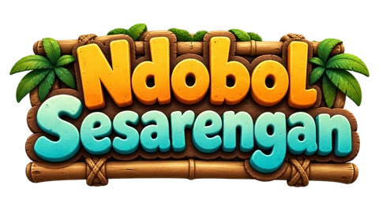

<p align="center"></p>

# Ndobol Sesarengan

Ikuti kabar dan perkembangan proyek: [LinkedIn · Ndobol Sesarengan](https://www.linkedin.com/company/ndobol-sesarengan/) · [X · @NdobolSakpole](https://x.com/NdobolSakpole).

**Satu getek. Banyak tingkah.** Game browser 3D untuk 1–4 pemain. Berjalanlah di atas rakit bambu untuk menjaga keseimbangan, putar badan, lalu **tahan Spasi untuk kentut dan mendorong getek**. Ambil sampah, hindari rintangan, dan usahakan semua kru sampai finis.

Sungainya terinspirasi **Selokan Mataram** dan **Kali Progo**. Mataram punya dinding kanal dan jembatan; Progo punya batu besar dan bagian berarus deras. Dunia, karakter, getek, tekstur, serta suara dibuat dari kode. Logo memakai aset asli proyek.

Proyek ini open source, dibuat oleh tim **DeEs**. Anda boleh menjalankan, mempelajari, dan mengembangkan kodenya sesuai [lisensi MIT](LICENSE). Ini masih prototipe: belum ada marketplace atau pembelian getek. Semua getek di garasi bebas dicoba.

**Main lewat internet:** [buka Ndobol Sesarengan](https://ndobol-game-teal.vercel.app/apps/web/index.html). Buka dengan browser yang memiliki MetaMask atau wallet EVM lain. Web Vercel, API Render, dan database Supabase sudah tersambung. **Klaim test MON sudah aktif dan transaksi uji berhasil**; lihat [bukti transaksi](#bukti-kesiapan-dan-transaksi-monad-testnet) di bawah. Jika halaman sudah terbuka sebelum aktivasi, muat ulang lalu login dan mainkan ronde baru.

## Baca ini sebelum mulai

- **Wallet wajib**, termasuk jika bermain sendiri. Gunakan browser dengan wallet EVM yang menyediakan koneksi browser, misalnya MetaMask. Di ponsel, buka game melalui browser di dalam aplikasi wallet.
- Game memakai **Monad Testnet, chain ID 10143**. Login meminta tanda tangan pesan; login tidak memindahkan uang dan tidak memakai gas.
- Anda bisa bermain tanpa mengisi private key server. Hasil tetap disimpan, tetapi klaim belum aktif sampai pengelola memasang dan mendanai kontrak reward.
- Bermain sendiri tetap memerlukan server game. Buat room, klik Siap, lalu Mulai. Tiga slot lain diisi bot.
- **Test MON bukan uang nyata.** Jangan gunakan seed phrase atau private key wallet utama untuk konfigurasi percobaan.

## 1. Jalankan di komputer sendiri

### Siapkan dua aplikasi

1. Pasang **Node.js 24 LTS, minimal 24.5**, dari [nodejs.org](https://nodejs.org/en/download). npm sudah ikut di dalamnya.
2. Pasang **Git** dari [git-scm.com](https://git-scm.com/downloads). Jika tidak ingin memasang Git, buka tombol **Code → Download ZIP** di GitHub lalu ekstrak ZIP.
3. Gunakan browser modern yang mendukung WebGL2 dan wallet browser. Aktifkan akselerasi grafis jika scene terlihat lambat.

Buka **Terminal** di macOS/Linux atau **PowerShell** di Windows. Periksa Node:

```sh
node --version
npm --version
```

Versi Node harus `v24.5.0` atau lebih baru pada seri 24. Jika perintah tidak ditemukan, tutup lalu buka Terminal setelah instalasi.

### Unduh dan jalankan

Jika memakai Git, salin perintah ini satu per satu:

```sh
git clone https://github.com/Ndobol-Sakpole/ndobol-game.git
cd ndobol-game
npm ci --ignore-scripts
npm run dev
```

Jika memakai ZIP, buka Terminal di folder hasil ekstrak yang berisi `package.json`, lalu jalankan dua perintah `npm` di atas. Nama folder ZIP biasanya `ndobol-game-main`.

Tunggu tulisan `Ndobol world` dan `Ndobol API`, lalu buka:

**http://127.0.0.1:4174/apps/web/index.html**

Biarkan Terminal tetap terbuka selama bermain. Untuk mematikan server, tekan **Ctrl+C** di Terminal. Untuk menjalankan lagi, masuk ke folder yang sama dan ketik `npm run dev`; instalasi `npm ci` tidak perlu diulang setiap kali bermain.

Tidak perlu membuat database secara manual. SQLite dibuat otomatis di `data/ndobol.sqlite`. Tidak perlu memasang Foundry atau Docker untuk sekadar bermain. Jangan membuka `index.html` dengan klik dua kali; game memerlukan server di atas.

## 2. Hubungkan wallet dan mulai bermain

1. Klik **CONNECT & START**.
2. Setujui koneksi wallet. Jika diminta, tambahkan atau pindah ke **Monad Testnet**.
3. Baca lalu tanda tangani pesan login Ndobol. Ini berbeda dari transaksi klaim.
4. Pilih nama, karakter, sungai, dan getek.
5. Klik **Buat room**, lalu **Siap → Mulai**. Anda bisa langsung bermain sendiri dengan bot.
6. Untuk bermain bersama, bagikan kode room kepada teman yang membuka **alamat server game yang sama**. Mereka menghubungkan wallet masing-masing, klik **Gabung**, masukkan kode, lalu klik **Siap**. Host menekan **Mulai**.

`127.0.0.1` hanya menunjuk komputer Anda sendiri. Teman di komputer lain tidak bisa masuk ke server Anda memakai alamat tersebut. Untuk bermain lintas perangkat/internet, gunakan deployment HTTPS pada bagian 5. Untuk uji beberapa pemain di satu komputer, gunakan profil browser dan alamat wallet berbeda; satu alamat tidak bisa mengisi dua slot pada room yang sama.

| Gerakan | Tombol |
| --- | --- |
| Berjalan di atas getek | W A S D |
| Memutar badan 360° | Panah kiri/kanan atau J/L |
| Kentut terus-menerus | **Tahan Spasi**; lepas untuk berhenti |
| Mengambil sampah di sisi tubuh | Q / E |

Tombol sentuh tersedia di layar ponsel. Kentut keluar dari belakang badan: jika karakter menghadap kanan, dorongan mengarah ke kanan. Rakit masih bisa meluncur karena momentum setelah tombol dilepas. Berjalan ke sisi berlawanan untuk mengimbangi kemiringan. Jika getek terbalik atau tenggelam, kru gugur dan **reward ronde hangus**.

Buka **Pengaturan** untuk mengganti kualitas grafis, suara, dan track di lobi. Pilih kualitas rendah jika gerakan terasa berat.

## 3. Bagaimana MON dihitung?

Sampah punya berat. Poin dihitung dari berat yang berhasil diambil, dengan perhitungan:

**1 kg = 0,00001 MON.** Contohnya 15 kg setara 0,00015 MON, sama dengan harga rancangan getek ban. Harga getek saat ini adalah katalog; transaksi membeli getek belum tersedia.

Reward hanya berasal dari sampah yang diambil pemain manusia pada ronde server yang sah. Sampah bot tidak menjadi reward wallet. Berat dalam game bukan bukti pengumpulan sampah fisik di dunia nyata.

Alur klaim:

1. Ronde selesai dan pemain selamat.
2. Server menyimpan hasil serta memeriksa berat/skor.
3. Server membuat bukti bertanda tangan EIP-712.
4. Pemain menekan **Klaim MON**, lalu menyetujui transaksi di wallet.
5. Kontrak membayar test MON dari pool yang sebelumnya diisi pengelola. UI baru menampilkan status dibayar setelah receipt dan event pembayaran cocok.

Pemain memerlukan test MON untuk biaya gas klaim. Ambil melalui [faucet Monad](https://faucet.monad.xyz). Klaim yang sama tidak bisa dibayar dua kali. Server publik proyek ini sudah memakai pool testnet yang didanai. **Jika menjalankan salinan sendiri**, ikuti bagian 4 untuk mengaktifkan reward server Anda; alamat dan key tidak diaktifkan otomatis oleh proses instalasi.

Biaya gas dibayar terpisah dan bisa lebih besar daripada reward. Pada transaksi uji di bawah, reward **0,00000059 test MON** dan gas **0,01336914 test MON**. Jadi saldo total wallet berkurang setelah biaya gas, walaupun reward benar-benar diterima. Nilai reward bukan janji keuntungan bersih.

## 4. Menyalakan reward di Monad Testnet — untuk pengelola

Langkah ini diperlukan hanya jika ingin membayar reward. Siapkan wallet pengelola dengan test MON, alamat owner, serta wallet signer server yang terpisah. Jangan bagikan private key di chat, GitHub, atau frontend.

1. Dari folder proyek, jalankan `npm run testnet:prepare`. Perintah ini membuat **`.env`**, menyiapkan wallet deployer dan signer terpisah, serta menampilkan alamat publiknya. Jika file/key sudah ada, isinya dipertahankan. Simpan cadangan `.env` secara privat; jangan menimpa file ini setelah wallet diisi.
2. Kirim test MON ke alamat **deployer** yang muncul: MetaMask → pilih Monad Testnet → **Kirim/Send** → alamat deployer → isi jumlah → konfirmasi. Untuk demo, siapkan 1 test MON untuk gas dan pool awal; biaya gas dapat berubah. Owner bawaan adalah deployer; untuk memakai wallet pengelola lain, isi alamat publiknya pada `CONTRACT_OWNER` sebelum deploy.
3. Pasang [Foundry](https://getfoundry.sh/). Jalankan `forge build --root contracts` lalu `forge test --root contracts`. Signer tidak memerlukan saldo; jangan kirim dana pool ke alamat signer.
4. Deploy kontrak:

```sh
npm run testnet:rewards -- deploy
```

5. Salin alamat hasil deploy ke `REWARD_POOL_ADDRESS` di `.env`. Isi `FUND_MON=0.01` untuk memasukkan 0,01 test MON ke pool demo, lalu jalankan:

```sh
npm run testnet:rewards -- fund
npm run testnet:rewards -- check
```

6. Setelah pemeriksaan benar, pool berisi dana dan tidak paused, isi `SIGNING_CHAIN_ID=10143` dan `REWARD_CLAIMS_ENABLED=true`. Restart server dengan Ctrl+C lalu `npm run dev`.
7. Mainkan ronde baru, ambil sampah sendiri, selesaikan tanpa mati, kemudian klaim dari wallet yang sama.

**Deploy dan fund mengirim transaksi.** Skrip menolak jaringan selain testnet 10143. Kontrak saat ini tidak menyediakan penarikan dana oleh owner; masukkan dana uji secukupnya. Alur lengkap, konfigurasi, dan batas pengujian ada di [panduan deployment](docs/deployment.md) serta [reward](docs/rewards.md).

Panduan langkah sederhana untuk database, wallet deployer, deploy, isi pool, dan klaim: [Mulai klaim test MON](docs/quickstart-rewards.md).

## Bukti kesiapan dan transaksi Monad Testnet

Jaringan: **Monad Testnet**, chain ID **10143**. Pemeriksaan pada **24 Oktober 2026**:

| Layanan | Bukti yang sudah diperiksa |
| --- | --- |
| [Web Vercel](https://ndobol-game-teal.vercel.app/apps/web/index.html) | Scene 3D dan tombol mulai tampil; modul Three.js dan protokol tersedia. |
| [API Render](https://ndobol-game.onrender.com/health) | Deploy sukses; `ok:true`, protokol 4, simulasi 30 Hz. |
| Supabase | Migrasi berhasil; leaderboard kedua track terbaca melalui API server. |
| Ronde publik otomatis | Mataram dan Progo mencapai finis; hasil tersimpan. Uji ulang Mataram menerima layar hasil dengan status penyimpanan sukses. [Catatan rinci](docs/cloud-verification-2026-10-24.json). |
| Pengujian lokal | 104 tes JavaScript, lint, dan build Vercel lulus. |

Status klaim dapat dilihat di [konfigurasi reward publik](https://ndobol-game.onrender.com/rewards/config): `chainId:10143`, alamat pool di bawah, dan `enabled:true`. API health juga mengembalikan `signing:true`.

Kontrak RiverRewards: [`0x94cb1588221e14f34563eede5401646df3730d4a`](https://testnet.monadscan.com/address/0x94cb1588221e14f34563eede5401646df3730d4a).

| Bukti on-chain | Hasil terkonfirmasi | Transaksi |
| --- | --- | --- |
| Deploy RiverRewards | Sukses, blok 73792492; bytecode, owner, dan signer cocok | [0x7665a0ad…4ba452a](https://testnet.monadscan.com/tx/0x7665a0adcf4d08001a9cf04d129a1785ecda4383e10cd610711cc497f4ba452a) |
| Pengisian pool | Sukses, **0,01 test MON**, blok 73792560 | [0x49cf62aa…1772fb99](https://testnet.monadscan.com/tx/0x49cf62aa680c4a637e12d3506c1b8b55d2e24e4315c998000f0424f71772fb99) |
| Klaim reward | Sukses, **59 gram → 0,00000059 test MON**, blok 73792849; event `RewardClaimed` cocok | [0xaac876c9…a71a2768](https://testnet.monadscan.com/tx/0xaac876c9dfd8788b11236f4a78ddc1f935cba233995b783622707223a71a2768) |

Klaim uji memakai wallet deployer `0x97e495Ba652eBDAFA41E6611053A61e41c4813f3` sebagai akun pemain uji. Ronde berjalan melalui input ke server Render dan hasilnya tersimpan di Supabase; pembayaran dikirim melalui CLI menggunakan bukti server yang sah. Ini bukan klaim dari wallet pribadi pemain lain. Penandatanganan ganda ditolak HTTP 409 dan simulasi klaim ulang ditolak `AlreadyClaimed`.

Saldo pool sesudah klaim uji: **0,00999941 test MON** pada 24 Oktober 2026 pukul 17:42 WIB; saldo selanjutnya berubah sesuai klaim/top-up. Hash lengkap, nominal wei, dan receipt ada di [rekaman deployment](docs/monad-testnet-deployment.json). Status `enabled:true` saja tidak membuktikan pembayaran; tabel di atas memakai receipt sukses dan event on-chain.

Untuk **isi ulang pool proyek ini**, pilih Monad Testnet di MetaMask → Kirim/Send → tempel **alamat kontrak RiverRewards di atas** → isi jumlah test MON → periksa alamat/jaringan lalu konfirmasi. Tidak perlu deploy ulang. Pool tidak menyediakan penarikan oleh owner, jadi masukkan dana demo secukupnya. Panduan salinan proyek sendiri: [deploy dan isi pool](docs/quickstart-rewards.md); catatan uji: [docs/perf.md](docs/perf.md).

## 5. Pasang di internet: Vercel + Render + Supabase

Tiga layanan ini punya tugas berbeda:

| Layanan | Tugas |
| --- | --- |
| Vercel | Menampilkan halaman dan dunia 3D. |
| Render | Menjalankan room, koneksi multiplayer, login wallet, dan penandatanganan hasil. |
| Supabase | Menyimpan hasil, leaderboard, nonce, dan bukti reward. |

### A. Supabase

Buat project Supabase. Buka **SQL Editor**, tempel isi [data/supabase/001_game.sql](data/supabase/001_game.sql), lalu jalankan. Simpan Project URL dan **secret key** (`sb_secret_…`) untuk Render. Key ini tidak boleh berada di Vercel atau file browser.

### B. Render

Jika layanan sudah dibuat manual, **tidak perlu membuat layanan baru**. Buka layanan Anda → **Settings → Build & Deploy**, lalu isi:

| Pengaturan | Isi |
| --- | --- |
| Branch | `main` |
| Root Directory | Kosong (folder utama repo) |
| Build Command | `npm ci --omit=dev --ignore-scripts && npm run build:api` |
| Start Command | `npm run start:api` |
| Health Check Path | `/health` |

Buka **Environment** lalu tambahkan:

| Nama | Nilai |
| --- | --- |
| `NODE_VERSION` | `24` |
| `NODE_ENV` | `production` |
| `HOST` | `0.0.0.0` |
| `DATA_BACKEND` | `supabase` |
| `TRUST_PROXY` | `true` |
| `SUPABASE_URL` | Project URL dari Supabase Anda |
| `SUPABASE_SECRET_KEY` | Secret key (`sb_secret_…`) dari Settings → API Keys |
| `ALLOWED_ORIGINS` | URL web Vercel Anda, misalnya `https://nama-game.vercel.app` |
| `SIGNING_CHAIN_ID` | `10143` |
| `REWARD_CLAIMS_ENABLED` | `false` selama kontrak belum siap |

`ALLOWED_ORIGINS` harus alamat web yang dibuka pemain, **bukan alamat API Render**. Tanpa `/` di akhir atau `/apps/web/index.html`. Jika perlu beberapa alamat, pisahkan dengan koma. Jangan pakai `*`. Bila Vercel belum punya alamat, isi sementara `https://game.example.invalid`; ganti setelah langkah C agar login bisa diterima.

Untuk pemasangan pertama tanpa kontrak, biarkan `REWARD_POOL_ADDRESS` kosong dan `REWARD_CLAIMS_ENABLED=false`. Key signer boleh sudah disiapkan; signing tetap nonaktif sampai alamat kontrak tersedia. Setelah kontrak dari langkah 4 siap, isi alamat pool dan aktifkan klaim. Jangan taruh key deployer di Render.

Simpan perubahan, lalu pilih **Manual Deploy → Deploy latest commit**. Periksa log sampai API berjalan. Layanan proyek ini: [https://ndobol-game.onrender.com/health](https://ndobol-game.onrender.com/health). Hasil yang benar memuat `"ok":true`. Untuk salinan proyek sendiri, gunakan URL Render Anda.

Alternatif pemasangan baru: pilih **Blueprint** dan hubungkan repo ini; Render membaca `render.yaml`. Tetap isi variabel di atas dan gunakan **satu instance**. `PUBLIC_API_ORIGIN` tidak diperlukan oleh API Render. Jika pengaturan lama masih memakai `npm run build`/`npm start`, skrip sekarang otomatis memilih API saat berada di Render.

### C. Vercel

Import repo ini, pilih preset **Other**, Node **24.x**, root directory tetap folder utama. `vercel.json` sudah mengatur build `npm run build:vercel` dan hasil `dist/game`.

Buka project → **Settings → Environment Variables**. Tambahkan:

```text
Nama: PUBLIC_API_ORIGIN
Nilai: https://ndobol-game.onrender.com
Lingkungan: Production, Preview
```

Ini alamat **API Render**, bukan alamat web Vercel. Jangan tambahkan `/health`, `/api`, atau `/rooms`. Alamat di atas sudah menjadi bawaan build Vercel proyek ini; variabel dapat menggantinya. **Jika memasang salinan proyek, wajib isi URL API milik Anda sendiri** agar tidak menghubungkan pemain ke server proyek asli.

Buka **Deployments**, deploy commit terbaru dari branch `main`. Jika mengulangi deployment lama, pastikan sumber commit sudah memuat perbaikan ini; redeploy commit lama akan mengulangi error lama. Setelah status **Ready**, buka tombol **Visit**, salin origin URL web (misalnya `https://nama-game.vercel.app`), lalu:

1. Buka Render → layanan API → **Environment**.
2. Ubah `ALLOWED_ORIGINS` menjadi URL web tersebut, tanpa path atau garis miring terakhir.
3. Simpan dan redeploy Render. Tunggu `/health` kembali memuat `"ok":true`.
4. Muat ulang halaman Vercel, hubungkan wallet, buat room, lalu uji dengan wallet kedua.

Build hanya menyalin file native dan menulis alamat API publik; tidak memakai bundler. Jangan menaruh private key atau service-role key di Vercel.

Render free dapat tidur saat tidak dipakai. Restart/deploy server mengakhiri room yang masih berjalan, tetapi data hasil di Supabase tetap ada. Pilih layanan yang selalu aktif jika diperlukan; pilihan paket dan biaya Anda tentukan sendiri. Vercel tidak menjalankan server WebSocket game ini. Konfigurasi terperinci: [docs/deployment.md](docs/deployment.md).

## Pilihan lain: Docker

Jika Docker Desktop sudah terpasang dan sedang berjalan, dari folder proyek jalankan:

```sh
docker compose up --build
```

Buka URL lokal yang sama pada port 4174. Untuk berhenti, tekan Ctrl+C lalu `docker compose down`. Data SQLite berada di volume Docker; jangan memakai `down -v` jika ingin menyimpannya. Cara Node di bagian 1 lebih sederhana untuk percobaan pertama.

## Jika menemui masalah

| Gejala | Yang perlu diperiksa |
| --- | --- |
| `node` / `npm` tidak ditemukan | Pasang Node24, lalu buka ulang Terminal. |
| PowerShell menolak `npm.ps1` | Gunakan `npm.cmd ci --ignore-scripts` dan `npm.cmd run dev`, atau Command Prompt. Tidak perlu melonggarkan kebijakan komputer. |
| Error `node:sqlite` | Node terlalu lama. Gunakan Node24.5+ pada seri24. |
| Muncul `ExperimentalWarning: SQLite` | Ini peringatan Node, bukan kegagalan game. Pastikan dua alamat server muncul. |
| `EADDRINUSE` / port sudah dipakai | Hentikan server game lain dengan Ctrl+C, lalu coba kembali. Jangan menjalankan dua `npm run dev` di port yang sama. |
| Halaman kosong / modul tidak terbaca | Buka lewat URL HTTP, bukan `file://`. Periksa WebGL2 dan akselerasi grafis. |
| Wallet tidak tersedia | Gunakan browser dengan wallet aktif; browser preview aplikasi mungkin tidak punya extension wallet. |
| Login ditolak / `ORIGIN_NOT_ALLOWED` | Pastikan API aktif dan `ALLOWED_ORIGINS` sama persis dengan origin browser. Coba login ulang setelah API restart. |
| Room teman tidak ditemukan | Pastikan kedua pemain memakai deployment yang sama dan kode room benar. |
| Build gagal `Set PUBLIC_API_ORIGIN` | Gunakan commit terbaru. Render: `npm run build:api`. Vercel: `npm run build:vercel` dan isi `PUBLIC_API_ORIGIN` seperti bagian 5. |
| API gagal setelah build berhasil | Periksa `ALLOWED_ORIGINS`, URL/key Supabase dan migrasi SQL. Selama belum ada kontrak, biarkan pool kosong dan flag klaim false. |
| Klaim nonaktif | Selesaikan ronde server, ambil sampah sendiri, jangan mati; pengelola perlu menyiapkan key signer, kontrak, dana, dan flag klaim. |
| Key signer sudah diisi tetapi klaim belum aktif | Key saja belum cukup. Buka `/rewards/config` pada API; jika `contract:null`, deploy kontrak lalu isi `REWARD_POOL_ADDRESS`. Danai pool sebelum mengaktifkan `REWARD_CLAIMS_ENABLED`. |
| Transaksi klaim gagal | Periksa jaringan10143, wallet penerima, test MON untuk gas, batas waktu bukti, dan saldo pool. Jangan menganggap gagal berarti sudah dibayar. |
| Game lambat | Pilih kualitas rendah, tutup tab3D lain, aktifkan akselerasi grafis. |

Untuk melaporkan bug, sertakan perangkat/browser, langkah kejadian, dan pesan error di [Issues](https://github.com/Ndobol-Sakpole/ndobol-game/issues). Jangan sertakan token, key, seed phrase, atau file `.env`.

## Untuk yang ingin mengembangkan kode

Frontend memakai HTML/CSS/JavaScript ES modules dan Three.js0.170.0; backend memakai Node, `ws`, `viem`, dan SQLite bawaan. Tidak ada framework frontend atau bundler. Supabase diakses hanya oleh API melalui HTTPS, tanpa SDK tambahan.

| Folder | Isi |
| --- | --- |
| `apps/web/` | Scene, karakter, kontrol, suara, UI wallet/room/hasil. |
| `services/api/` | Simulasi server30Hz, WebSocket, autentikasi, signing. |
| `shared/` | Aturan fisika, perhitungan reward, protokol4, ABI. |
| `data/` | SQLite lokal dan migrasi/adapter Supabase produksi. |
| `contracts/` | Solidity, Foundry tests, deployment. |
| `infra/` | Server lokal, Docker, packaging, pengujian beban, template CI. |
| `tests/`, `docs/` | Pengujian dan penjelasan teknis. |

```sh
npm run lint
npm test
npm run test:load
forge test --root contracts
```

Panduan lain: [kontribusi](docs/CONTRIBUTING.md), [protokol](docs/protocol.md), [signing](docs/signing.md), [visual/suara](docs/visual-audio.md). Situs promosi berada di repo terpisah: [ndobol-landing](https://github.com/Ndobol-Sakpole/ndobol-landing).

## Lisensi

Kode dan dokumentasi asli: [MIT](LICENSE). Three.js dan OpenZeppelin mempertahankan lisensinya. Logo/identitas merek tidak otomatis ikut lisensi kode; lihat [ASSETS.md](ASSETS.md) dan [THIRD_PARTY_NOTICES.md](THIRD_PARTY_NOTICES.md). Membagikan versi modifikasi tidak boleh menyiratkan dukungan resmi tim Ndobol.
